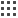
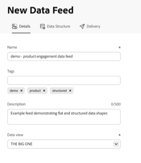

# Creare un feed di dati

{{release-limited-testing}}

Durante la creazione di un feed di dati, fornisci ad Adobe:

* Informazioni sulla destinazione in cui si desidera inviare i file di dati non elaborati

* Dati da includere in ciascun file

* Frequenza con cui vengono inviati i dati (incluso il ritardo di elaborazione per acquisire gli eventi in ritardo)

Prima di creare un feed di dati, è importante avere una conoscenza di base dei feed di dati e assicurarsi di soddisfare tutti i prerequisiti. Per ulteriori informazioni, consulta [Panoramica sui feed di dati](data-feed-overview.md).

## Creare e configurare un feed di dati {#create-and-configure-data-feed}

<!-- markdownlint-disable MD034 -->

>[!CONTEXTUALHELP]
>id="cja_datafeed_export_file"
>title="Manifesto"
>abstract="Scegli se includere un file manifesto con ogni consegna di feed di dati. I file manifesto contengono informazioni per ciascun file incluso nel feed di dati. Quando invii i dati di un feed di dati in un singolo pacchetto, puoi scegliere di includere un file finale (.fin), ma è consigliabile utilizzare i file manifest. "

<!-- markdownlint-enable MD034 -->

<!-- markdownlint-disable MD034 -->

>[!CONTEXTUALHELP]
>id="cja_datafeed_notify"
>title="Notifica dei problemi, quando è completo e quando è scaduto"
>abstract="Specifica uno o più indirizzi e-mail a cui inviare una notifica quando il feed di dati viene completato, è scaduto o riscontra problemi. Separa più indirizzi e-mail con una virgola."

<!-- markdownlint-enable MD034 -->

<!-- markdownlint-disable MD034 -->

>[!CONTEXTUALHELP]
>id="cja_datafeed_frequency_granularity"
>title="Frequenza e granularità"
>abstract="**Frequenza di consegna** (feed live): frequenza con cui viene consegnato il feed di dati. Le consegne orarie contengono i dati relativi a un’ora, mentre quelle giornaliere contengono i dati relativi a un giorno.
Ogni consegna inoltre ripensa a una finestra di elaborazione continua di 30 giorni per qualificare i segmenti, calcolare le sessioni e mantenere i valori delle dimensioni. La finestra di elaborazione e il ritardo di elaborazione possono influenzare entrambi gli eventi inclusi.

**Granularità** (feed di backfill): intervallo di tempo utilizzato per dividere i dati storici. Ogni blocco contiene i dati relativi a un giorno e viene consegnato il più rapidamente possibile, non una sola volta al giorno. Questo campo è sempre impostato su Giornaliero e non può essere modificato.
"

<!-- markdownlint-enable MD034 -->

1. Accedi a [experiencecloud.adobe.com](https://experiencecloud.adobe.com) utilizzando le credenziali Adobe ID.

1. Seleziona [!UICONTROL **Customer Journey Analytics**] dal selettore di app  in alto a destra nell’interfaccia.

1. Nella barra di navigazione superiore, vai a [!UICONTROL **Componenti**] > [!UICONTROL **Esportazioni**].

1. Selezionare la scheda [!UICONTROL **Feed dati**].

1. Seleziona [!UICONTROL **Crea**] nell&#39;angolo superiore destro dello schermo.

   In alternativa, se in precedenza non è stato creato alcun feed di dati, selezionare [!UICONTROL **Crea feed di dati**] all&#39;interno della tabella vuota.

   Viene visualizzata una pagina con le seguenti schede: [!UICONTROL **Dettagli**], [!UICONTROL **Struttura dati**] e [!UICONTROL **Consegna**].

   

1. Nella scheda [!UICONTROL **Dettagli**], completa i campi seguenti:

   | Campo | Funzione |
   |---------|----------|
   | [!UICONTROL **Nome**] | Nome del feed dati. I nomi devono essere univoci all’interno della visualizzazione dati selezionata e possono contenere fino a 255 caratteri. <!--[Learn more](/help/export/analytics-data-feed/df-faq.md#must-feed-names-be-unique)--> |
   | [!UICONTROL **Tag**] | Applica eventuali tag al feed dati per facilitarne la classificazione. <!--You can filter on tags as described in [Filter and search the list of data feeds](/help/export/analytics-data-feed/df-manage-feeds.md#filter-and-search-the-list-of-data-feeds) in [Manage data feeds](/help/export/analytics-data-feed/df-manage-feeds.md).--> |
   | [!UICONTROL **Descrizione**] | Specifica una descrizione per il feed di dati (fino a 500 caratteri). La descrizione aggiunta è visibile quando si modifica il feed dati. |
   | [!UICONTROL **Visualizzazione dati**] | Selezionare la visualizzazione dati contenente i dati che si desidera esportare.
Quando selezioni una visualizzazione dati, tieni presente quanto segue:
 <ul><li>Se vengono creati più feed di dati per la stessa visualizzazione dati, ogni feed di dati deve avere definizioni di colonne diverse.</li><li>L’elenco delle colonne disponibili dipende dalla società di accesso a cui appartiene la visualizzazione dati selezionata. Se modifichi la visualizzazione dati, l’elenco delle colonne disponibili può cambiare. </li></ul> |

1. Seleziona [!UICONTROL **Avanti**].

1. Nella scheda [!UICONTROL **Data structure**], assicurati che nel campo **[!UICONTROL Data view]** sia selezionata la visualizzazione dati corretta.

   <!--add screenshot-->

1. Nel menu a discesa [!UICONTROL **Segmenti**], cerca e seleziona eventuali segmenti per filtrare i dati inclusi nel feed.

   Quando applichi più segmenti, questi vengono uniti insieme a un operatore AND. Per unire i segmenti con un operatore OR, devi prima creare un nuovo segmento nel generatore di segmenti, quindi applicare il nuovo segmento al feed di dati.

   I segmenti applicati in questo caso si aggiungono a eventuali segmenti già applicati nella visualizzazione dati.

1. (Facoltativo) Nella barra a sinistra, utilizza il campo **search** per individuare componenti specifici. In alternativa, selezionare l&#39;icona **Ordina**  per applicare una delle seguenti opzioni di ordinamento:

   | Opzione | Funzione |
   | --------- | ---------- |
   | [!UICONTROL **Consigliato**] | Ordina i componenti a partire da quelli consigliati. I componenti utilizzati più di frequente e più di recente da te o da altri nella tua organizzazione vengono visualizzati più in alto nell’elenco. |
   | [!UICONTROL **Alfabetico**] | Ordina alfabeticamente i componenti. |
   | [!UICONTROL **Per categorie**] | Ordina componenti simili a [!UICONTROL **Consigliato**], con la differenza che le metriche calcolate e le metriche standard sono raggruppate separatamente invece di essere combinate tra loro. |

1. Aggiungi componenti alla configurazione del feed dati. La barra a sinistra mostra solo i componenti validi per i feed di dati.

   * **Trascina e rilascia**: trascina i componenti dalla barra a sinistra all&#39;area di lavoro. Tenere premuto **[!UICONTROL Maiusc]** oppure tenere premuto **[!UICONTROL Comando]** (macOS) o **[!UICONTROL Ctrl]** (Windows) per selezionare e trascinare più componenti contemporaneamente.
   * **Pulsante Plus**: seleziona l&#39;icona Più  accanto a qualsiasi componente nella barra a sinistra per aggiungerlo all&#39;area di lavoro.
   * **[!UICONTROL Mostra tutto]**: seleziona **[!UICONTROL Mostra tutto]** nella parte inferiore dell&#39;elenco dei componenti per aprire una finestra di dialogo che mostra tutti i componenti disponibili. Selezionare la casella di controllo accanto a ogni componente che si desidera aggiungere, quindi selezionare **[!UICONTROL Aggiungi selezionati]**. Quando un termine di ricerca o un tag di filtro è attivo nella barra a sinistra, viene visualizzato anche un pulsante **[!UICONTROL Aggiungi tutto]** che consente di aggiungere tutti i risultati filtrati contemporaneamente.

   Quando aggiungi i campi, tieni presente quanto segue:

   * Alcuni componenti sono obbligatori, non supportati o soggetti a restrizioni nei feed di dati. Per informazioni dettagliate, vedere [Disponibilità dei componenti nei feed di dati](/help/components/exports/cja-data-feeds/df-components.md).

   * Quando aggiungi un componente che appartiene a un campo array XDM (ad esempio, un campo proposta Adobe Journey Optimizer) o a un campo mappa, una finestra di dialogo richiede di aggiungere altri componenti dello stesso sottoevento. Nell’output del feed dati, tutti questi componenti vengono visualizzati in una singola colonna. Per ulteriori informazioni, vedi [Componenti evento secondario nei feed dati](/help/components/exports/cja-data-feeds/df-sub-event.md)

1. (Facoltativo) Riordina i componenti nell’area di lavoro trascinandoli. L’ordine definito viene mantenuto come ordine delle colonne nel file di feed dati esportato.

1. (Facoltativo) Ridimensiona le colonne nell’area di lavoro trascinando il bordo della colonna.

   Le larghezze delle colonne vengono salvate in un cookie e rimangono invariate la volta successiva che ritorni a questo feed di dati nello stesso browser.

1. (Facoltativo) Modifica l’ID di output di un componente. L’ID di output è il nome della colonna nell’output del feed dati.

   Per impostazione predefinita, l’ID di output è l’ID del componente in snake_case. La modifica dell’ID di output influisce solo su questo feed di dati. Non modifica l’ID del componente nella visualizzazione dati. L’anteprima dello schema mostra sia l’ID componente che l’ID output.

   1. Passa il puntatore del mouse su un componente nell&#39;area di lavoro, quindi seleziona l&#39;icona delle informazioni .

   1. Seleziona l&#39;icona di modifica  accanto all&#39;ID, quindi specifica un nuovo ID di output.

      <!--add screenshot-->

   Gli ID di output devono:

   * Sii univoco all’interno del feed di dati.
   * Contengono solo lettere, numeri e trattini bassi (`_`). Spazi, punti (`.`), trattini (`-`), barre (`/`) e altri caratteri speciali non sono consentiti.
   * Inizia con una lettera o un trattino basso.
   * Non può contenere più di 255 caratteri.

   Gli ID di output non possono iniziare con `_cja`, che è riservato per l&#39;utilizzo in Adobe.

1. (Facoltativo) Utilizza i pannelli **[!UICONTROL Riepilogo feed]** e **[!UICONTROL Anteprima schema]** sul lato destro della pagina per rivedere la struttura dei dati prima di procedere:

   * Il **[!UICONTROL riepilogo feed]** mostra un conteggio live dei componenti, delle colonne, delle dimensioni e delle metriche totali aggiunti.
   * L&#39;**[!UICONTROL Anteprima schema]** mostra una rappresentazione JSON dello schema del feed dati che viene aggiornata quando si aggiungono o si riordinano i componenti.
   * Il pulsante **[!UICONTROL Righe di esempio]** apre una finestra di dialogo in cui vengono visualizzate righe di output di esempio per verificare che la struttura sia corretta. Questa finestra di dialogo mostra solo i dati di esempio e non riflette i dati effettivi.

   <!--add screenshot-->

1. Nella scheda [!UICONTROL **Consegna**], nella sezione [!UICONTROL **Pianifica**], scegli il tipo di feed da creare (live o backfill), quindi specifica l&#39;intervallo di reporting, la frequenza e altre opzioni di configurazione:

   <!--add screenshot-->

   | Campo | Funzione |
   |---------|----------|
   | [!UICONTROL **Tipo di feed**] | Seleziona il tipo di feed da creare:<ul><li>[!UICONTROL **Feed live**]: esporta dati correnti e futuri.</li><li>[!UICONTROL **Feed di backfill**]: esporta dati storici. </li></ul> |
   | [!UICONTROL **Data di inizio**] | La data di inizio del feed di dati. Per i feed live, deve essere nella data odierna o in una data futura. Per i feed di backfill, deve essere una data passata all’interno della finestra di conservazione dei dati della visualizzazione dati. La data di inizio è basata sul fuso orario della visualizzazione dati. |
   | [!UICONTROL **Data di scadenza**]  Disponibile solo per i feed attivi | La data in cui il feed dati scade e non viene più eseguito. La data è basata sul fuso orario della visualizzazione dati. |
   | [!UICONTROL **Data di fine**]  Disponibile solo per i feed di backfill | La data in cui termina il feed di dati. La data di fine non può essere nel futuro. La data è basata sul fuso orario della visualizzazione dati. |
   | [!UICONTROL **Frequenza**]  Disponibile solo per feed live | Seleziona la frequenza con cui inviare il feed di dati. Gli eventi con marche temporali che rientrano nella finestra di frequenza sono inclusi nella consegna del feed di dati. 
Selezionare questa opzione per includere dati relativi a un&#39;ora o a un giorno.
<ul><li>**Giornaliero**: i feed contengono dati relativi a un intero giorno, dalla mezzanotte alla mezzanotte nel fuso orario della visualizzazione dati.</li><li>**Oraria**: i feed contengono dati relativi a una sola ora.</li></ul> 
Ogni consegna utilizza anche una finestra continua di elaborazione di 30 giorni, che precede e include la finestra di frequenza, per qualificare i segmenti, calcolare le sessioni e mantenere i valori delle dimensioni. La finestra di elaborazione e il campo [!UICONTROL **Ritardo elaborazione**] possono influenzare entrambi gli eventi inclusi. Per ulteriori informazioni, vedere [Informazioni sulla finestra di elaborazione](#data-feed-processing-window) e [Informazioni sul ritardo di elaborazione](#data-feed-processing-delay).
 |
   | [!UICONTROL **Granularità**]  Disponibile solo per i feed di backfill | Intervallo di tempo utilizzato per suddividere i dati storici in blocchi. Ogni blocco contiene dati relativi a un’intera giornata, dalla mezzanotte alla mezzanotte nel fuso orario della visualizzazione dati. 
La granularità determina il modo in cui i dati vengono raggruppati, non la frequenza con cui vengono consegnati. I dati di backfill vengono consegnati il più rapidamente possibile, non una volta al giorno.

Questo campo è sempre impostato su [!UICONTROL **Giornaliero**] e non può essere modificato.
 |
   | [!UICONTROL **Ritardo elaborazione**] | Il periodo di tempo che Customer Journey Analytics attende prima di elaborare un file del feed dati. Nel feed di dati sono inclusi eventuali eventi che arrivano durante il ritardo di elaborazione sono inclusi nel feed di dati. 
Scegli un ritardo sufficientemente lungo per consentire il completamento dell’elaborazione dei dati più lenti nella connessione. Se il ritardo è troppo breve, i dati ancora in fase di elaborazione non verranno inclusi nel file del feed di dati.

Il ritardo di elaborazione minimo è di 2 ore. Il valore predefinito è basato sui set di dati presenti nella connessione. Ad esempio, se l’unione è abilitata, il valore predefinito è 6 ore. Alcuni tipi di dati richiedono un ritardo più lungo. Il ritardo scelto dipende dai tipi di dati presenti nella connessione, ad esempio dati di streaming, batch, uniti, ricerca o profilo.

Prima di configurare questa opzione, consulta i dettagli e gli esempi descritti nella sezione seguente, [Comprendere il ritardo di elaborazione](#data-feed-processing-delay).
 |
   | [!UICONTROL **Formato di compressione**] | Seleziona il formato di compressione per i file di output Parquet consegnati alla destinazione cloud. Scegli uno dei seguenti formati:<ul><li>[!UICONTROL **Snappy**]: compressione e decompressione veloci con dimensioni file moderate. Ampiamente supportato da piattaforme di dati moderne come BigQuery, Snowflake e Apache Spark.</li><li>[!UICONTROL **GZip**]: ampiamente compatibile, anche con strumenti che non supportano Snappy in modalità nativa. Consigliato se la pipeline a valle richiede uno standard di compressione ampiamente riconosciuto.</li><li>[!UICONTROL **Z Standard (Zstd)**]: elevata efficienza di compressione con decompressione rapida. Adatto se la riduzione delle dimensioni del file è una priorità e i tuoi strumenti supportano Zstd.</li></ul> |

1. Nella scheda [!UICONTROL **Consegna**], nella sezione [!UICONTROL **Destinazione**], configura la destinazione in cui desideri inviare i dati.

   >[!NOTE]
   >
   >Quando configuri la destinazione di rapporto, tieni presente quanto segue:
   >
   ><!--* Adobe recommends using a cloud account for your report destination. [Legacy FTP and SFTP accounts](/help/components/locations/configure-import-accounts.md) are available, but are not recommended.-->
   >* Tutti gli account cloud configurati in precedenza sono disponibili per l’utilizzo con i feed di dati. Puoi configurare gli account cloud da Gestione posizioni in [Componenti > Esportazioni > Account posizione](/help/components/exports/cloud-export-accounts.md).
   >
   >* Gli account cloud sono associati al tuo account utente Customer Journey Analytics. Gli altri utenti non possono utilizzare o visualizzare gli account cloud configurati, a meno che non vengano resi disponibili a tutti gli utenti dell’organizzazione.
   >
   >* È possibile modificare qualsiasi percorso creato dal gestore Percorsi in [Componenti > Esportazioni > Percorsi](/help/components/exports/cloud-export-locations.md).

   Completa i campi seguenti:

   | Campo | Funzione |
   |---------|----------|
   | [!UICONTROL **Visualizza destinazioni per tutti gli utenti**] | Se sei un amministratore di sistema, puoi abilitare questa opzione per visualizzare le destinazioni create da tutti gli utenti dell’organizzazione. Se questa opzione è disabilitata, vengono visualizzate solo le destinazioni create dall’utente. |
   | [!UICONTROL **Account**] | Esegui una delle operazioni seguenti:<ul><li>**Utilizza un account esistente:** Seleziona il menu a discesa accanto al campo **[!UICONTROL Account]**. In alternativa, inizia a digitare il nome dell’account, quindi selezionalo dal menu a discesa. 
Gli account sono disponibili solo se sono stati configurati o se sono condivisi con un&#39;organizzazione di cui fai parte.
</li><li>**Crea un nuovo account:** Seleziona **[!UICONTROL Aggiungi account]** nel menu a discesa **[!UICONTROL Account]**. Per informazioni su come configurare l&#39;account, vedere [Configurare gli account di esportazione cloud](/help/components/exports/cloud-export-accounts.md).</li></ul> |
   | [!UICONTROL **Posizione**] | Esegui una delle operazioni seguenti:<ul><li>**Usa una posizione esistente:** Seleziona il menu a discesa accanto al campo **[!UICONTROL Posizione]**. In alternativa, inizia a digitare il nome della posizione, quindi selezionalo dal menu a discesa.</li><li>**Crea un nuovo percorso:** Seleziona **[!UICONTROL Aggiungi percorso]** nel menu a discesa **[!UICONTROL Percorso]**. Per informazioni su come configurare il percorso, vedere [Configurare i percorsi di esportazione cloud](/help/components/exports/cloud-export-locations.md).</li></ul> |
   | [!UICONTROL **Ignora percorso predefinito o nome file**] | Abilita questa opzione per ignorare il percorso o il nome file predefinito impostato per la posizione selezionata. La sostituzione si applica solo a questo feed di dati e determina dove vengono inviati i file di feed dati.
Quando questa opzione è abilitata, viene visualizzato il campo [!UICONTROL **Percorso o nome file**].
 |
   | [!UICONTROL **Percorso o nome file**]  Disponibile solo quando [!UICONTROL **Ignora percorso predefinito o nome file**] è abilitato | Specificare un percorso o un nome di file (o entrambi) per determinare dove vengono inviati i file all&#39;interno del percorso selezionato. Per salvare i file nella cartella di primo livello del percorso, specificare `/`.
Per i feed live, puoi utilizzare una qualsiasi delle seguenti variabili per rendere dinamico il percorso o il nome file:
<ul><li>**{yyyy}**: anno di calendario a 4 cifre (distinzione maiuscole/minuscole)</li><li>**{yy}**: anno di calendario a 2 cifre (distinzione maiuscole/minuscole)</li><li>**{MM}**: mese di 2 cifre (distinzione maiuscole/minuscole)</li><li>**{dd}**: giorno di 2 cifre (distinzione maiuscole/minuscole)</li><li>**{HH}**: ore a 2 cifre (distinzione maiuscole/minuscole)</li><li>**{mm}**: minuti a 2 cifre (distinzione maiuscole/minuscole)</li><li>**{ss}**: secondi a 2 cifre (distinzione maiuscole/minuscole)</li><li>**{fff}**: nanosecondi di 3 cifre (distinzione maiuscole/minuscole)</li><li>**{instance_id}**: UUID richiesta (istanza)</li><li>**{export_id}**: UUID esportazione (pianificazione)</li><li>**{idx}**: indice con inizio da 0 (incrementato per ciascun file)</li><li>**{total}**: numero totale di file per l&#39;intero processo di trasferimento</li><li>**{completion_millis}**: tempo di trasferimento in millisecondi</li></ul>
Ad esempio, se specifichi `${yyyy}/${MM}/${dd}/my-feed-${instance_id}-${idx}`, un feed live consegnato il 15 gennaio 2027 avrà il percorso e il nome di file seguenti: `[prefix_folder_name]/2027/01/15/my-feed-[UUID]-1.parquet`
 |
   | [!UICONTROL **Notifica problemi, quando completato, e quando scade**] | Specifica uno o più indirizzi e-mail a cui inviare una notifica quando il feed di dati viene completato, è scaduto o riscontra problemi. Separa più indirizzi e-mail con una virgola. |
   | [!UICONTROL **Abilita manifesto**] | Scegli se includere un file manifesto con ogni consegna di feed di dati. Il file manifesto contiene informazioni per ciascun file incluso nel feed di dati. |

1. Seleziona **[!UICONTROL Salva]**.

## Comprendere la finestra di elaborazione {#data-feed-processing-window}

La **finestra di elaborazione** è un periodo continuo di 30 giorni che precede e include la finestra di frequenza (ora o giorno) selezionata. Customer Journey Analytics utilizza i dati nella finestra di elaborazione per elaborare ogni consegna di feed di dati. La finestra di elaborazione è sempre di 30 giorni e non può essere modificata.

La finestra di frequenza determina quali eventi sono inclusi nella consegna. La finestra di elaborazione fornisce il contesto storico necessario per classificare correttamente tali eventi, ad esempio per quali segmenti sono idonei, a quale sessione appartengono e quali valori di dimensione persistono.

La finestra di elaborazione, insieme alla finestra di frequenza, funziona in modo simile alla finestra di reporting di Analysis Workspace. Tuttavia, sono presenti [differenze chiave](/help/components/exports/cja-data-feeds/df-comparison-workspace.md#processing-window). Tali differenze possono causare discrepanze di dati tra i rapporti di Workspace e le consegne di feed di dati.

La qualificazione dei segmenti, il calcolo della sessione, la persistenza delle dimensioni e le trasformazioni di campo derivate vengono presi in considerazione durante l’elaborazione dei dati all’interno della finestra di elaborazione:

### Qualificazione segmento

Quando un segmento viene applicato alla definizione del feed dati, i dati all’interno della finestra di elaborazione determinano quali eventi, sessioni o persone sono idonee per il segmento. L’impostazione del contenitore del segmento determina l’ambito. (I contenitori possibili sono: Persona, Sessione o Evento. B2B include i seguenti contenitori aggiuntivi: account globale, account, opportunità, gruppo di acquisto.)

>[!BEGINSHADEBOX]

**Esempio:**

Supponiamo di voler creare un feed di dati per comprendere il comportamento degli utenti che fanno parte di una specifica campagna di marketing, la Campagna B.

A questo scopo, applichi un segmento al feed di dati denominato _Utenti nella campagna B_, indicando che solo gli eventi associati agli utenti in questo segmento devono essere inclusi nel feed di dati.

In questo caso, gli utenti vengono inclusi nel feed di dati solo se soddisfano **entrambe** le seguenti condizioni:

* L’utente aveva un evento con una marca temporale all’interno della finestra della frequenza del feed dati (l’ora o il giorno specificato del feed dati).
* L&#39;utente si è qualificato per il segmento **Campaign B _all&#39;interno della finestra di elaborazione**._

  Ad esempio, un utente qualificato per il segmento 9 giorni fa **è incluso** nel feed di dati. Un utente qualificato 45 giorni fa **non è incluso**, perché l&#39;evento non rientra nell&#39;intervallo di elaborazione di 30 giorni.

>[!ENDSHADEBOX]

### Calcolo della sessione

I limiti di sessione vengono calcolati utilizzando tutti gli eventi nella finestra di elaborazione, non solo gli eventi nella finestra di frequenza. Una sessione avviata prima della finestra di frequenza viene ancora riconosciuta come stessa sessione.

L’ID sessione dipende dalla persona, dall’ora di inizio della sessione e dalle impostazioni della sessione nella visualizzazione dati. Una sessione mantiene lo stesso ID sessione tra le consegne, in modo da poter unire gli eventi di una sessione che si estende su più consegne orarie o giornaliere.

Quando si lavora con le sessioni nei feed dati, considera quanto segue:

* Se una sessione è stata avviata prima della finestra di elaborazione, i relativi eventi precedenti non sono disponibili, pertanto i valori della sessione possono differire da Analysis Workspace. Per ulteriori informazioni, vedere [Informazioni sulle discrepanze di dati tra feed di dati e Analysis Workspace](/help/components/exports/cja-data-feeds/df-comparison-workspace.md).
* La modifica delle impostazioni della sessione nella visualizzazione dati cambia gli ID sessione. Gli ID sessione nelle consegne successive non corrisponderanno agli ID sessione nelle consegne precedenti.

### Persistenza Dimension

Quando imposti la persistenza su una singola dimensione, imposti anche una scadenza per determinare per quanto tempo l’elemento dimensione persiste oltre l’evento su cui è impostato.

La finestra di elaborazione influisce sulla persistenza delle dimensioni quando la scadenza è impostata su una delle seguenti opzioni nella visualizzazione dati:

* [!UICONTROL **Finestra di reporting persona**]: la finestra di elaborazione diventa la nuova finestra di reporting per ogni dimensione nella definizione del feed dati che utilizza [!UICONTROL **Finestra di reporting persona**] come scadenza.
* [!UICONTROL **Ora personalizzata**]: se il tempo personalizzato selezionato si estende oltre la finestra di elaborazione, il tempo personalizzato viene ignorato e la finestra di elaborazione viene utilizzata per la scadenza della dimensione per ogni dimensione nella definizione del feed dati che utilizza [!UICONTROL **Ora personalizzata**] come scadenza. I valori che si sono verificati prima della finestra di elaborazione non vengono considerati.

  Per ulteriori informazioni sull&#39;impostazione della persistenza sulle dimensioni all&#39;interno della visualizzazione dati, vedere [Impostazioni dei componenti di persistenza](/help/data-views/component-settings/persistence.md).

>[!BEGINSHADEBOX]

**Esempio:**

Supponiamo che nel tuo feed di dati desideri sapere quali utenti della campagna di marketing hanno visto originariamente prima di visitare il tuo sito.

A questo scopo, imposta la persistenza sulla dimensione Campagne con Originale come modello di allocazione.

In questo caso, la campagna originale viene visualizzata nell&#39;output del feed dati solo se gli utenti soddisfano **entrambi** delle seguenti condizioni:

* L’utente aveva un evento con una marca temporale all’interno della finestra della frequenza del feed dati (l’ora o il giorno specificato del feed dati).

* L&#39;utente si è qualificato per la campagna originale **qualche volta nella finestra di elaborazione**.

  Se l&#39;utente è qualificato per la campagna originale 9 giorni fa, la campagna originale **è inclusa** nel feed di dati. Se l&#39;utente è qualificato 45 giorni fa, la campagna originale **non è inclusa**, perché non rientra nell&#39;intervallo di elaborazione di 30 giorni.

>[!ENDSHADEBOX]

### Trasformazioni di campo derivate

Tutte le funzioni di campo derivate che fanno riferimento ai contenitori utilizzano la finestra di elaborazione nelle esportazioni di feed di dati. Quali funzionalità di data sono disponibili nei campi derivati? <!--Not sure how this applies.-->

## Comprendere il ritardo di elaborazione {#data-feed-processing-delay}

<!-- markdownlint-disable MD034 -->

>[!CONTEXTUALHELP]
>id="cja_datafeed_processing_delay"
>title="Ritardo di elaborazione"
>abstract="Quantità di tempo che il sistema attende prima di elaborare un file di feed dati. Eventuali eventi in ritardo che arrivano durante il ritardo vengono inclusi nel feed.
Il ritardo minimo di elaborazione è di 2 ore, ma alcuni tipi di dati richiedono più tempo. Scegli un ritardo sufficientemente lungo per i dati più lenti nella connessione. Se il ritardo di elaborazione è troppo breve, alcuni dati potrebbero non essere inclusi nel feed.
"

<!-- markdownlint-enable MD034 -->

### Funzionamento del ritardo di elaborazione

Il ritardo di elaborazione è il tempo che Customer Journey Analytics attende prima di elaborare un file di feed dati. Nel feed di dati sono inclusi eventuali eventi che arrivano durante il ritardo di elaborazione sono inclusi nel feed di dati.

I ritardi di elaborazione sono necessari per vari motivi, ad esempio per tenere conto della latenza della pipeline, per dare alle implementazioni mobili l’opportunità ai dispositivi offline di connettersi e inviare dati o per adattarsi ai processi lato server della tua organizzazione nella gestione dei file elaborati in precedenza.

Il ritardo di elaborazione minimo è di 2 ore, ma alcuni tipi di dati richiedono un ritardo maggiore.

>[!BEGINSHADEBOX]

**Esempio:**

Supponiamo che un feed di dati orario includa dati compresi tra le 13:00 e le 14:00 e che il ritardo di elaborazione sia di 2 ore. L’elaborazione del file di feed dati inizia alle 16:00 e include tutti i dati ricevuti prima dell’inizio dell’elaborazione.

>[!ENDSHADEBOX]

### Scegli un ritardo di elaborazione in base ai tuoi dati

Diversi tipi di dati richiedono tempi diversi per essere disponibili in Customer Journey Analytics. I dati attraversano due fasi di elaborazione e il tempo di ciascuna fase si aggiunge al totale.

Scegli un ritardo di elaborazione sufficientemente lungo da consentire ai dati più lenti della connessione di completare entrambe le fasi. Se il ritardo è troppo breve, i dati ancora in fase di elaborazione non verranno inclusi nel file del feed di dati.

Quando crei un feed di dati, per impostazione predefinita il ritardo di elaborazione viene impostato su un valore consigliato in base ai set di dati della connessione. Ad esempio, se l’unione è abilitata per la connessione, il valore predefinito è 6 ore. Puoi scegliere un ritardo più breve, fino al minimo di 2 ore, ma viene visualizzato un avviso perché alcuni dati potrebbero non essere inclusi nel feed di dati.

#### Fase 1: arrivo dei dati nel data lake di Experience Platform

I tempi di arrivo variano in base al tipo di dati che stai raccogliendo. Scegli un ritardo che tenga conto del tipo di dati che stai raccogliendo.

* **Set di dati evento da Edge Network o acquisizione in streaming**: i dati in genere arrivano nel data lake entro 60 minuti (vedi [Latenze](/help/technotes/guardrails.md#latencies)).

* **Set di dati del connettore di origine di Analytics**: i dati in genere arrivano nel data lake entro 2,25 ore (vedi [Latenze](/help/technotes/guardrails.md#latencies)).

  <!--Default delay for Analytics source connector datasets is TBD (Oct 19 decision); add when confirmed.-->

* **Set di dati da altri connettori di origine**: la latenza varia in base al connettore di origine e al momento dell&#39;invio dei batch. L’elaborazione a monte in Experience Platform, come la preparazione dati, può aggiungere più tempo.

* **Set di dati di ricerca**: il tempo di arrivo dei dati nel data lake dipende dalla frequenza con cui vengono caricati i dati. I dati di ricerca vengono in genere caricati come copia completa di un database, in cui solo una piccola percentuale di record è stata modificata. Carica i dati di ricerca in batch più piccoli per ridurre il tempo di elaborazione.

  I caricamenti di piccole dimensioni vengono in genere elaborati con il minor ritardo possibile.

  I caricamenti di grandi dimensioni (ad esempio, un caricamento settimanale di milioni di record) vengono elaborati con priorità inferiore e possono richiedere da 3 a 4 ore in più. In caso di caricamenti di grandi dimensioni, i dati dell’evento non vengono ritardati, ma i valori di ricerca potrebbero non riflettere gli aggiornamenti più recenti.

* **Set di dati profilo**: il tempo di arrivo dei dati nel data lake dipende dalla frequenza con cui vengono caricati i dati. I dati del profilo vengono generalmente acquisiti in batch di grandi dimensioni, ad esempio uno snapshot giornaliero dell’intera tabella del profilo. Carica i dati del profilo in batch più piccoli per ridurre il tempo di elaborazione.

  I caricamenti di piccole dimensioni vengono in genere elaborati con il minor ritardo possibile.

  I caricamenti di grandi dimensioni (ad esempio, un caricamento settimanale di milioni di record) vengono elaborati con priorità inferiore e possono richiedere da 3 a 4 ore in più. In caso di caricamenti di grandi dimensioni, i dati dell’evento non vengono ritardati, ma i valori del profilo potrebbero non riflettere gli aggiornamenti più recenti.

#### Fase 2: i dati vengono acquisiti dal data lake in Customer Journey Analytics

I tempi di acquisizione dei dati variano a seconda che l’unione sia abilitata o meno per il set di dati.

* **Set di dati non uniti**: l&#39;operazione può richiedere fino a 90 minuti (vedere [Latenze](/help/technotes/guardrails.md#latencies)).

* **Set di dati uniti**: l&#39;unione può aggiungere fino a 4 ore oltre i 90 minuti necessari per i set di dati non uniti (vedi [Latenze](/help/technotes/guardrails.md#latencies)). Se per la connessione è abilitata l’unione, il ritardo predefinito è di 6 ore. I dati aggiornati da una ripetizione dell’unione non sono generalmente inclusi nei file di feed dati già elaborati.

>[!BEGINSHADEBOX]

**Esempio:**

Se la connessione include più tipi di dati, scegliere un ritardo che tenga conto dei dati più lenti. Nell’esempio seguente, sono circa 8 ore.

L’unione può aggiungere fino a 4 ore per l’acquisizione in Customer Journey Analytics. Aggiungi 4 ore al ritardo per eventuali dati con identità unite, in modo da compensare questo intervallo di tempo.

| Origine dati | Fase 1: Arrivo nel data lake | Fase 2: acquisizione in Customer Journey Analytics | Totale |
| --- | --- | --- | --- |
| Acquisizione in streaming o Edge Network | 60 minuti | 90 minuti 
Senza unione
 | 2,5 ore |
| Connettore di origine di Analytics | 2,25 ore | 90 minuti + 4 ore per l’unione 
Con unione
 | 7,75 ore |

>[!ENDSHADEBOX]

