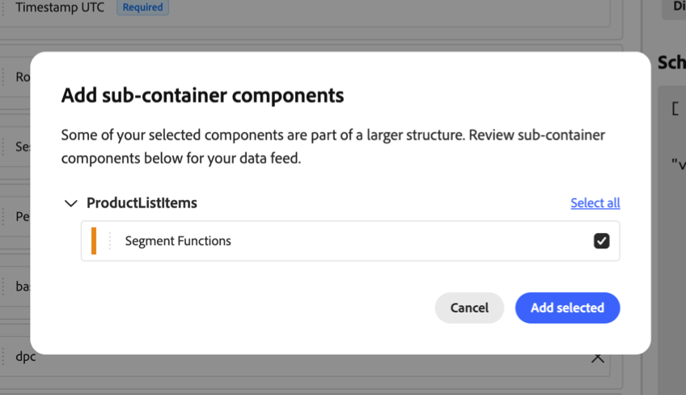

# Componenti di eventi secondari nei feed dati

{{release-limited-testing}}

I componenti dei sottoeventi sono dimensioni e metriche basate sui campi all’interno di un array o di una mappa nello schema XDM. Ti consentono di analizzare i dati a un livello più granulare rispetto al livello dell’evento, ad esempio i singoli prodotti in un acquisto. Per informazioni sull&#39;utilizzo di questi dati nei segmenti, vedere [Eventi secondari](/help/components/segments/sub-event.md).

Utilizza le seguenti informazioni per comprendere come vengono visualizzati nei feed di dati Customer Journey Analytics i componenti di eventi secondari provenienti dai campi array e mappa.

## Comprendere i componenti degli eventi secondari

### Componenti di evento secondario nello schema XDM

Nello schema XDM, ogni elemento di un array (un array di stringhe o un array di oggetti) è un sottoevento. Ogni voce in un campo mappa è anche un evento secondario, come descritto in [Campi mappa nei feed di dati](#use-map-fields-in-data-feeds). Le dimensioni e le metriche basate sui campi all’interno di un evento secondario sono componenti di un evento secondario.

Per visualizzare gli eventi secondari nello schema XDM in Adobe Experience Platform, seleziona [!UICONTROL **Schemi**], quindi espandi un evento che contiene eventi secondari.

Nell&#39;esempio seguente, `Product list items` è un array di oggetti contenente vari componenti di eventi secondari.


### Differenze tra eventi secondari tra Analysis Workspace e feed di dati

I componenti degli eventi secondari sono rappresentati in modo diverso in Analysis Workspace e nei feed di dati in Customer Journey Analytics.

| Posizione | Modalità di rappresentazione dei componenti evento secondario |
| --- | --- |
| **Analysis Workspace (in Customer Journey Analytics)** | Selezionabile come singolo componente, separato da qualsiasi gerarchia visibile. |
| **Feed dati (in Customer Journey Analytics)** | Rappresentata come un gruppo, con la gerarchia intatta. |

### Differenze tra eventi secondari di Adobe Analytics e Customer Journey Analytics

I dati dei sottoeventi (come più dettagli di prodotto in un singolo evento di acquisto) vengono visualizzati in modo diverso nei feed dati di Customer Journey Analytics rispetto ai feed dati di Adobe Analytics. La tabella seguente confronta il modo in cui ogni prodotto rappresenta i dati dei sottoeventi.

| Prodotto | Visualizzazione dei dati di eventi secondari nei feed di dati | Esempio: elenco prodotti |
| --- | --- | --- |
| **Adobe Analytics** | Viene ridotta a una stringa delimitata in una singola colonna. | Un elenco di prodotti contiene più prodotti raggruppati in una singola stringa:<p>`Power Tools;Cordless Drill;1;129.99,Power Tools;Drill Battery Pack;2;39.98` <!--screenshot of what this looks like: product lists, list vars. --></p> |
| **Customer Journey Analytics** | I componenti evento secondario mantengono la gerarchia definita nello schema XDM. Raggruppati nella stessa colonna, mostrano la gerarchia relazionale all’evento principale e ai sottoeventi di pari livello. | Un elenco di prodotti mantiene la gerarchia definita nello schema XDM come array:<p>`[{"category":"Power Tools","product":"Cordless Drill","quantity":1,"revenue":129.99},{"category":"Power Tools","product":"Drill Battery Pack","quantity":2,"revenue":39.98}]` <!--screenshot of what this looks like: product lists, list vars. --></p> |

{style="table-layout:auto"}

### Esempio di evento secondario: prodotti in un evento di acquisto

Un cliente acquista due prodotti in un unico ordine: un trapano senza fili e due pacchi batteria per trapano. L&#39;implementazione invia un singolo evento di acquisto che include entrambi i prodotti nell&#39;array di oggetti `productListItems`:

```json
{
  "eventType": "commerce.purchases",
  "timestamp": "2026-09-16T14:32:07.512Z",
  "commerce": {
    "purchases": { "value": 1 }
  },
  "productListItems": [
    { "SKU": "CD-2000", "name": "Cordless Drill", "quantity": 1, "priceTotal": 129.99 },
    { "SKU": "BP-2000", "name": "Drill Battery Pack", "quantity": 2, "priceTotal": 39.98 }
  ]
}
```

Questo evento contiene due eventi secondari, uno per ogni oggetto nell&#39;array `productListItems`. La tabella seguente mostra quali campi appartengono all’evento e quali appartengono ai suoi sottoeventi.

| Livello | Campi | Descrizione dei campi |
| --- | --- | --- |
| **Evento** | `eventType`, `timestamp`, `commerce.purchases.value` | L’acquisto nel suo insieme. Ogni campo ha un valore per l’evento. La metrica **Ordini** conta `1` per questo evento, indipendentemente dal numero di prodotti in essa contenuti. |
| **Evento secondario** | `SKU`, `name`, `quantity`, `priceTotal` in ogni oggetto `productListItems` | Un singolo prodotto nell’acquisto. Ogni campo ha un valore per prodotto. Ad esempio, `quantity` è `1` per il trapano senza fili e `2` per il pacchetto batteria del trapano. |

{style="table-layout:auto"}

>[!NOTE]
>
>I sottoeventi includono solo i dati inviati con l’evento. Customer Journey Analytics non ricostruisce il contenuto del carrello in base a eventi precedenti, ad esempio aggiunte al carrello o estrazioni. Affinché i prodotti vengano visualizzati come eventi secondari di un evento di acquisto, l&#39;implementazione deve includerli in `productListItems` per tale evento di acquisto.

## Aggiungere componenti evento secondario a un feed di dati

Quando aggiungi un componente evento secondario a un feed di dati, una finestra di dialogo richiede di aggiungere gli altri componenti dallo stesso evento secondario.



I campi dello stesso evento secondario vengono visualizzati nell’area di lavoro come un gruppo nidificato comprimibile anziché come un elemento semplice.


Questo gruppo riflette la struttura dati sottostante.

Nell’output del feed dati, tutti questi componenti vengono visualizzati come array nidificati in una singola colonna.

Per informazioni su come aggiungere componenti, inclusi i componenti evento secondario, a un feed di dati, vedere [Creare un feed di dati](/help/components/exports/cja-data-feeds/create-feed.md).

## Eseguire query sui dati degli eventi secondari nell’output del feed dati

Poiché i dati dell&#39;evento secondario [&#x200B; vengono visualizzati in modo diverso nei feed dati di Customer Journey Analytics](#sub-event-differences-between-adobe-analytics-and-customer-journey-analytics), le query utilizzate per tale evento sono diverse da quelle utilizzate per i feed dati di Adobe Analytics.

Gli esempi seguenti mostrano come trovare gli eventi che includono un prodotto specifico. Negli esempi viene utilizzata la sintassi BigQuery di Google, in cui `UNNEST` espande un array in righe. Altri data warehouse supportano lo stesso approccio con le proprie funzioni di array, ad esempio `FLATTEN` in Snowflake o `explode` in Databricks.

+++ Eseguire query sui dati dei prodotti nei feed di dati di Customer Journey Analytics

Nei feed di dati di Customer Journey Analytics, gli stessi due prodotti vengono visualizzati come un array di oggetti nella colonna `product_list_items`. Non è richiesta alcuna analisi del delimitatore:

```json
{
  "row_id": "01K3F2M9-...-4821",
  "timestamp_utc": "2026-09-16T14:32:07.512000Z",
  "product_list_items": [
    { "category": "Power Tools", "product": "Cordless Drill", "quantity": 1, "revenue": 129.99,
      "events": {"event1": 1}, "merchandising": {"eVar10": "DrillBundle"} },
    { "category": "Power Tools", "product": "Drill Battery Pack", "quantity": 2, "revenue": 39.98,
      "events": {"event1": 1}, "merchandising": {"eVar10": "DrillBundle"} }
  ]
}
```

La modalità di scrittura della query dipende dal fatto che si desideri una riga per evento o una riga per prodotto corrispondente.

**Restituire una riga per evento**

Per filtrare gli eventi senza modificare il numero di righe, utilizzare una funzione di matrice come `UNNEST` all&#39;interno di una sottoquery `EXISTS`:

```sql
SELECT row_id, timestamp_utc, product_list_items
FROM `project.dataset.cja_data_feed` AS f
WHERE EXISTS (
  SELECT 1
  FROM UNNEST(f.product_list_items) AS item
  WHERE item.product = 'Cordless Drill'
);
```

Questa query restituisce una riga per ogni evento corrispondente, con l&#39;array `product_list_items` completo intatto, indipendentemente dal numero di prodotti nell&#39;array corrispondenti.

**Restituire una riga per prodotto corrispondente**

Per restituire una riga per ogni prodotto corrispondente, spostare la funzione di matrice nella clausola `FROM` esterna:

```sql
SELECT f.row_id, f.timestamp_utc, item.product, item.quantity, item.revenue
FROM `project.dataset.cja_data_feed` AS f,
     UNNEST(f.product_list_items) AS item
WHERE item.product = 'Cordless Drill';
```

Un evento con più di un prodotto corrispondente viene visualizzato come più righe e le colonne dell&#39;evento, ad esempio `row_id`, vengono ripetute su ogni riga. Utilizzare questo approccio solo quando sono necessari dettagli a livello di prodotto. Per contare gli eventi nei risultati, utilizzare `COUNT(DISTINCT row_id)` invece di contare le righe.

Questo approccio si applica a qualsiasi campo array nello schema XDM, non solo ai prodotti.

+++

+++ Eseguire query sui dati dei prodotti nei feed di dati di Adobe Analytics

Nei feed dati di Adobe Analytics, un evento con due prodotti acquistati insieme viene visualizzato come una singola stringa delimitata nella colonna `product_list`:

```text
Power Tools;Cordless Drill;1;129.99;event1=1;eVar10=DrillBundle,Power Tools;Drill Battery Pack;2;39.98;event1=1;eVar10=DrillBundle
```

Per trovare gli eventi che includono un trapano senza fili, analizzare questa stringa con un&#39;espressione regolare:

```sql
SELECT hitid_high, hitid_low, post_evar10
FROM aa_hit_data
WHERE REGEXP_CONTAINS(product_list, r'(^|,)[^;]*;Cordless Drill;')
```

+++

## Utilizzare i campi mappa nei feed di dati

Mappa i campi nelle coppie chiave-valore dell’archivio schemi XDM. I feed di dati esportano ogni mappa come array di oggetti, allo stesso modo degli altri [dati sub-evento](#query-sub-event-data-in-data-feed-output). Ogni oggetto contiene la chiave della mappa e il relativo valore come campi separati.

I nomi dei campi nell&#39;output provengono dagli ID dei componenti configurati per il feed dati, non da nomi fissi come `key` o `value`. Gli esempi in questa sezione utilizzano ID di componenti di esempio.

<!-- Confirm with Nate before publishing: how the outer array column is named in the output (for example, `survey_responses`). -->

### Mappe semplici

Le mappe semplici sono il tipo di mappa che puoi creare nel tuo schema. Ogni chiave è una stringa e ogni valore è una stringa o un numero intero.

Ad esempio, una mappa di sondaggio memorizza ogni domanda come chiave e la risposta come valore:

```json
{
  "_yourtenant": {
    "surveyResponses": {
      "How did you hear about us?": "Search engine",
      "How likely are you to recommend us?": 9
    }
  }
}
```

Nell&#39;output del feed dati, `survey_question` e `survey_answer` sono gli ID componente per la chiave e il valore:

```json
{
  "survey_responses": [
    { "survey_question": "How did you hear about us?", "survey_answer": "Search engine" },
    { "survey_question": "How likely are you to recommend us?", "survey_answer": 9 }
  ]
}
```

### Mappa identità

Ogni identità nel campo [`identityMap`](https://experienceleague.adobe.com/en/docs/experience-platform/xdm/field-groups/profile/identitymap) viene esportata come un oggetto. L’oggetto contiene lo spazio dei nomi dell’identità (la chiave), insieme all’identificatore, allo stato autenticato e al flag primario. Lo spazio dei nomi si ripete per ogni identità in tale spazio dei nomi.

Vengono esportati solo gli attributi della mappa delle identità che esistono come dimensioni nella visualizzazione dati e che aggiungi al feed di dati.

```json
{
  "identity_map": [
    { "identity_namespace": "ECID", "identity_id": "83290187457380573620940587193016478103", "authenticated_state": "ambiguous", "is_primary": true },
    { "identity_namespace": "CRMID", "identity_id": "C-1048576", "authenticated_state": "authenticated", "is_primary": false }
  ]
}
```

### Mappe nidificate

Alcuni campi definiti da Adobe, ad esempio `segmentMembership`, sono mappe di mappe. I feed di dati li uniformano in un unico array, con la chiave di primo e di secondo livello come campi separati in ciascun oggetto. La chiave di primo livello si ripete in ogni oggetto a cui si applica, quindi non vengono persi dati o relazioni.

Ad esempio, `segment_namespace` e `segment_id` sono gli ID componente per la chiave di primo livello e la chiave di secondo livello:

```json
{
  "segment_membership": [
    { "segment_namespace": "ups", "segment_id": "04a81716-43d6-4e7a-a49c-f1d8b3129ba9", "status": "realized" },
    { "segment_namespace": "ups", "segment_id": "53cba6b2-a23b-454a-8069-fc41308f1c0f", "status": "exited" }
  ]
}
```


