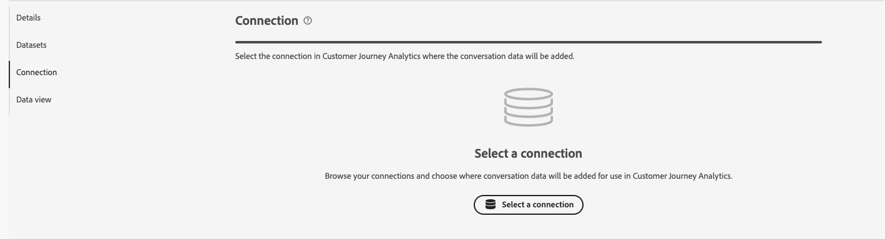
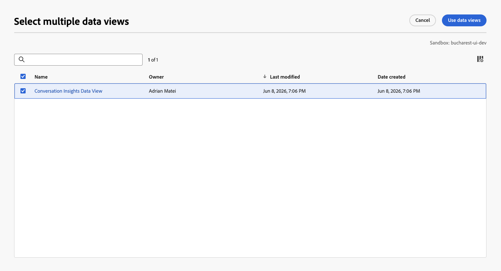

# Creare o modificare le configurazioni

Informazioni sulla conversazione consente di analizzare le conversazioni dalle esperienze agente offerte ai clienti. Queste esperienze agente possono essere basate su modelli di linguaggio di grandi dimensioni (Large Language Model, LLM) o su conversazioni umane. Ad esempio, un chatbot che interagisce con le trascrizioni di un cliente o di un call center.
Tramite Informazioni sulla conversazione sei in grado di comprendere l’impatto degli agenti sui risultati effettivi degli utenti.

Tramite l’interfaccia di configurazione di Informazioni sulla conversazione puoi creare o modificare rapidamente una configurazione e gli artefatti associati (connessione, visualizzazioni dati e altro).

Quando crei o modifichi una configurazione di Informazioni sulla conversazione, specifichi la sandbox e i set di dati dell’evento che contengono prompt, risposte e dati di feedback. Seleziona anche la connessione Customer Journey Analytics alla quale desideri aggiungere questi set di dati. E la visualizzazione dati a cui desideri aggiungere le metriche e le dimensioni di Informazioni sulla conversazione.

Solo gli amministratori di sistema possono creare o modificare le configurazioni di Informazioni sulla conversazione.

Puoi creare o modificare le configurazioni dall&#39;interfaccia [Configurazioni approfondimenti conversazione](./manage.md).

## Ripristina set di dati combinato mancante

Se si modifica una configurazione e il set di dati di blend generato per la configurazione non esiste più, selezionare **[!UICONTROL Ripristina]** per rigenerare il set di dati di blend.

## Passaggi di configurazione

Per ogni configurazione:

1. Nella sezione **[!UICONTROL Dettagli]**, specifica le seguenti informazioni:

   

   | Campo | Descrizione |
   |---------|----------|
   | **[!UICONTROL Nome]** | Specifica un nome per la configurazione. |
   | **[!UICONTROL Sandbox]** | Seleziona la sandbox di Experience Platform che contiene i set di dati di prompt, risposte ed eventi di feedback che desideri aggiungere alla connessione. Viene visualizzata una notifica se non sono disponibili set di dati compatibili per la sandbox selezionata. |

1. Nella sezione **[!UICONTROL Set di dati]**, specifica le seguenti informazioni:

   

   | Campo | Descrizione |
   |---------|----------|
   | **[!UICONTROL Richiede il set di dati evento]** | Seleziona il set di dati che contiene i dati dell’evento prompt. |
   | **[!UICONTROL Set di dati evento risposte]** | Seleziona il set di dati che contiene i dati dell’evento risposte. |
   | **[!UICONTROL Set di dati evento feedback]** | Seleziona il set di dati che contiene i dati dell’evento di feedback. |

   Quando un set di dati contiene sia prompt che risposte, selezionare lo stesso set di dati per **[!UICONTROL Set di dati evento Prompts]** e **[!UICONTROL Set di dati evento Responses]**.

   L&#39;opzione per [specificare le conversazioni di blend](#blend-specification) tramite **[!UICONTROL Configurare la specifica di blend]** è disponibile una sola volta:
   * Configurazione completata.
   * Sono disponibili tutti i set di dati.
   * Hai [autorizzazioni Customer Journey Analytics per modificare le connessioni](/help/technotes/access-control.md).

1. Nella sezione **[!UICONTROL Connessione]**, se non è già configurata alcuna connessione, utilizzare **[!UICONTROL Seleziona una connessione]** per selezionare una connessione.

   

   Se una connessione è già configurata, selezionare  **[!UICONTROL Modifica]** per selezionare un&#39;altra connessione.

   

   Nella finestra di dialogo **[!UICONTROL Seleziona una connessione]**:

   

   1. Seleziona la casella di controllo accanto alla connessione alla quale desideri aggiungere i set di dati dei prompt, delle risposte e degli eventi di feedback.
   1. Selezionare **[!UICONTROL Usa connessione]**.

   * Per eseguire una ricerca nell&#39;elenco delle connessioni tra cui selezionare, utilizzare il campo .
   * Per configurare le colonne da visualizzare nella tabella, selezionare . Nella finestra di dialogo **[!UICONTROL Personalizza tabella]**, seleziona le colonne da visualizzare. Quindi selezionare **[!UICONTROL Applica]**.

1. Nella sezione **[!UICONTROL Visualizzazioni dati]**, se non è già configurata alcuna visualizzazione dati, selezionare **[!UICONTROL Seleziona visualizzazioni dati]** per selezionare le visualizzazioni dati.

   Se le visualizzazioni dati sono già configurate, selezionare  **[!UICONTROL Modifica selezione visualizzazione dati]** per riconfigurare la selezione delle visualizzazioni dati.

   Nella finestra di dialogo **[!UICONTROL Seleziona più visualizzazioni dati]**:

   

   1. Seleziona una o più visualizzazioni dati da utilizzare per la configurazione di Informazioni sulla conversazione.

   1. Selezionare **[!UICONTROL Utilizza visualizzazioni dati]** per utilizzare le visualizzazioni dati. Seleziona Annulla per annullare.

   * Per eseguire ricerche nell&#39;elenco delle visualizzazioni dati da cui selezionare, utilizzare il campo .
   * Per configurare le colonne da visualizzare nella tabella, selezionare . Nella finestra di dialogo **[!UICONTROL Personalizza tabella]**, seleziona le colonne da visualizzare. Quindi selezionare **[!UICONTROL Applica]**.

1. Per completare la configurazione:

   * Seleziona **[!UICONTROL Elimina]** per una nuova configurazione non creata.

   * Seleziona **[!UICONTROL Salva per dopo]** per una nuova configurazione da salvare, ma non desideri creare l&#39;artefatto per (ad esempio, aggiornamenti alle visualizzazioni dati). Puoi rivedere la configurazione in un secondo momento e terminare la creazione effettiva della configurazione.

   * Seleziona **[!UICONTROL Crea]** per creare la nuova configurazione.

   * Seleziona **[!UICONTROL Salva]** per salvare la configurazione modificata.

   * Seleziona **[!UICONTROL Ripristina]** per ripristinare la configurazione e rigenerare un nuovo set di dati di blend per la configurazione.

   * Seleziona **[!UICONTROL Esci]** per ignorare eventuali modifiche alla configurazione.

## Specifica di fusione

>[!CONTEXTUALHELP]
>id="conversationinsights_blend_specification"
>title="Configura specifica di fusione"
>abstract="Puoi modificare la specifica di fusione solo dopo aver completato questa configurazione di Informazioni sulla conversazione, tutti i set di dati sono disponibili e disponi delle autorizzazioni di Customer Journey Analytics per modificare le connessioni."
>additional-url="https://experienceleague.adobe.com/en/docs/analytics-platform/using/technotes/access-control" text="Controllo degli accessi"

>[!CONTEXTUALHELP]
>id="conversationinsights_dataset_winner"
>title="Set di dati vincitore"
>abstract="Seleziona il set di dati che determina il valore per uno o più campi con nome corrispondente (se un contenitore) nel set di dati di conversazione blend."

Dopo aver creato una configurazione, puoi configurare [il modo in cui vengono unite le conversazioni dai set di dati di prompt, risposte, feedback e segnali](/help/conversation-insights/overview.md#how-it-works).

Questa specifica ti consente di selezionare il set di dati che determina il valore dei campi denominati in modo corrispondente (se un contenitore) nel set di dati di conversazione blend.

Ad esempio: se desideri che il nome del campo **[!UICONTROL Prodotto da]** nel set di dati di conversazione misto sia definito da un campo denominato simile nel set di dati di feedback, seleziona **[!UICONTROL Set di dati di feedback]** dal menu a discesa **[!UICONTROL Vincitore set di dati]** per tale campo.

Per specificare la conversazione di blend:

1. Selezionare **[!UICONTROL Configura specifica blend]**.

1. Nella finestra di dialogo **[!UICONTROL Specifica fusione]**, per ogni **[!UICONTROL Nome campo]**, controlla il **[!UICONTROL Vincitore set di dati]** suggerito e, facoltativamente, seleziona un set di dati diverso.

   * Per ogni campo abilitato, selezionare un altro **[!UICONTROL vincitore del set di dati]**. Puoi selezionare tra **[!UICONTROL Set di dati Prompts]**, **[!UICONTROL Set di dati Responses]** e **[!UICONTROL Set di dati Feedback]**.
   * Per ogni campo contenitore, è possibile selezionare un altro **[!UICONTROL vincitore del set di dati]** per aggiornare tutti i campi che appartengono al contenitore. Puoi selezionare tra **[!UICONTROL Set di dati Prompts]**, **[!UICONTROL Set di dati Responses]** e **[!UICONTROL Set di dati Feedback]**.
   * Non puoi selezionare un **[!UICONTROL vincitore del set di dati]** per i campi condivisi tra i set di dati di conversazione (prompt, risposte, feedback e segnali). Questi campi fanno parte dei seguenti gruppi di campi:

     | Nome campo: | Gruppo di campi | Set di dati vincitore |
     |---|---|---|
     | **[!UICONTROL prompt]** | `conversation.prompt.*` | **[!UICONTROL Richiede il set di dati]** |
     | **[!UICONTROL risposta]** | `conversation.response.*` | **[!UICONTROL Set di dati risposte]** |
     | **[!UICONTROL feedback]** | `conversation.feedback.*` | **[!UICONTROL Set di dati di feedback]** |
     | **[!UICONTROL agentExperience]** | `agentExperience.*` | **[!UICONTROL Set di dati risposte]** |
     | **[!UICONTROL segnali]** | `conversation.signals.*` | **[!UICONTROL Set di dati dei segnali]** |

   * Nessuna selezione di **[!UICONTROL vincitori del set di dati]** è disponibile per campi di identità specifici, ad esempio **[!UICONTROL ID conversazione]** o **[!UICONTROL ID svolta]**.

1. Seleziona **[!UICONTROL Salva]** per salvare la specifica. Selezionare **[!UICONTROL Annulla]** per annullare la specifica.

## Verifica della visualizzazione dati

Le visualizzazioni dati configurate in [Passaggi di configurazione](#configuration-steps) hanno **[!UICONTROL Informazioni sulla conversazione]** come valore per **[!UICONTROL Integrazioni]** in [Visualizzazioni dati](/help/data-views/manage-dataviews.md).

Per ciascuna delle visualizzazioni dati configurate:

* **Contenitori**: la [scheda Contenitori](/help/data-views/create-dataview.md#containers) contiene un nuovo **[!UICONTROL Nome contenitore]**: **[!UICONTROL conversazione]** con **[!UICONTROL Nome visualizzato]**: **[!UICONTROL Contenitore]** come ulteriore **[!UICONTROL Sistema]** **[!UICONTROL Tipo contenitore]**.
* **Componenti**: sono presenti cartelle di campi schema aggiuntive. Ad esempio: agentExperience e conversazione. Inoltre, vengono aggiunti automaticamente i seguenti componenti:

  | Metriche | Tipo di dati dello schema | Percorso dello schema |
  |---|---|---|
  | Feedback cliente | Stringa | eventType |
  | Sentiment positivi | Stringa | Campi derivati |
  | Raccomandazioni | Stringa | eventType |
  | Turni di parola | Stringa | eventType |

  | Dimensioni | Tipo di dati dello schema | Percorso dello schema |
  |---|---|---|
  | ID agente | Stringa | `agenticExperience.agents.agentID` |
  | Nome agente | Stringa | `agenticExperience.agents.name` |
  | Nome concierge | Stringa | `agenticExperience.name` |
  | Versione concierge | Stringa | `agenticExperience.version` |
  | ID conversazione | Stringa | `conversation.conversationID` |
  | Nome conversazione | Stringa | `conversation.conversationName` |
  | Nome del segnale di conversazione | Stringa | `conversation.signals.name` |
  | Valore booleano del riepilogo della conversazione | Booleani | `conversation.signals.values.booleanValue` |
  | Affidabilità del riepilogo della conversazione | Doppio | `conversation.signals.values.confidence` |
  | Chiave dei metadati del riepilogo della conversazione | Stringa | `conversation.signals.values.metadata.key` |
  | Valore numerico del riepilogo della conversazione | Doppio | `conversation.signals.values.numberValue` |
  | Qualificatori del riepilogo della conversazione | Stringa | `conversation.signals.values.qualifiers` |
  | Segnali di tono conversazione | Stringa | `conversation.signals.attributes.tones.values` |
  | Ambiente | Stringa | `agenticExperience.environment` |
  | Classificazione del feedback | Stringa | Campi derivati |
  | Classificazione della valutazione del feedback | Stringa | `conversation.feedback.rating.classification` |
  | Scopo della sezione feedback | Stringa | `conversation.feedback.raw.purpose` |
  | Origine del feedback | Stringa | `conversation.feedback.source` |
  | Frase | Stringa | `conversation.signals.attributes.subjects.values.phrase` |
  | Testo non elaborato della risposta | Stringa | `conversation.response.raw.text` |
  | Origine risposta | Stringa | `conversation.response.source` |
  | Classificazione del sentiment | Stringa | Campi derivati |
  | Nome abilità | Stringa | `agenticExperience.agents.skills.name` |
  | Versione abilità | Stringa | `agenticExperience.agents.skills.version` |
  | Valore | Stringa | `agenticExperience.agents.skills.parameters.value` |

<!--

1. In the Data views dialog, select the checkbox next to one or more data views that you want to use when analyzing Experience Platform audience data within Analysis Workspace. These data views are automatically configured with Experience Platform audience data for reporting.

1. Select **[!UICONTROL Use data views]**.

1. Select **[!UICONTROL Create]** to create the configuration.

   >[!IMPORTANT]
   >
   >Because the profile dataset is updated once per day, audiences are available in Customer Journey Analytics data views on the day after you create the audience analysis configuration.

1. After 24 hours, [view audience dimensions in the data view](#view-audience-dimensions-in-the-data-view) to verify that the audience dimensions are available in the data views that you selected. 

## View audience dimensions in the data view

After you [create an audience analysis configuration](#create-an-audience-analysis-configuration), you can verify that audience dimensions were added to the data views that you selected during the configuration.

To view audience dimensions in the data view, you must be a product profile administrator for the product profile that the data view is assigned to. For more information, see [Access control](/help/technotes/access-control.md).

To view the audience analysis dimensions in the data view:

1. In Customer Journey Analytics, select **[!UICONTROL Data Management]** > **[!UICONTROL Data views]**.

1. In the **[!UICONTROL Dimensions]** section, the following dimensions should now be available:

   * **[!UICONTROL Audience Name]**

   * **[!UICONTROL Audience Origin]**

   * **[!UICONTROL Exited Audience Origin]**

   * **[!UICONTROL Exited Audience Name]**

   Note that each of these dimensions was added to the profile dataset that is associated with the merge policy that you selected during the audience analysis configuration, and each was added to the new lookup dataset that was created.

   

1. Use the audience analysis dimensions in Analysis Workspace. 

   Users who have access to use the data view in Analysis Workspace can now see the new dimensions and use them in their analyses. For information about how to use the audience analysis dimensions in Analysis Workspace, see [Analyze Experience Platform audiences in Customer Journey Analytics](/help/connections/audience-analysis/analyze-audiences.md).

-->